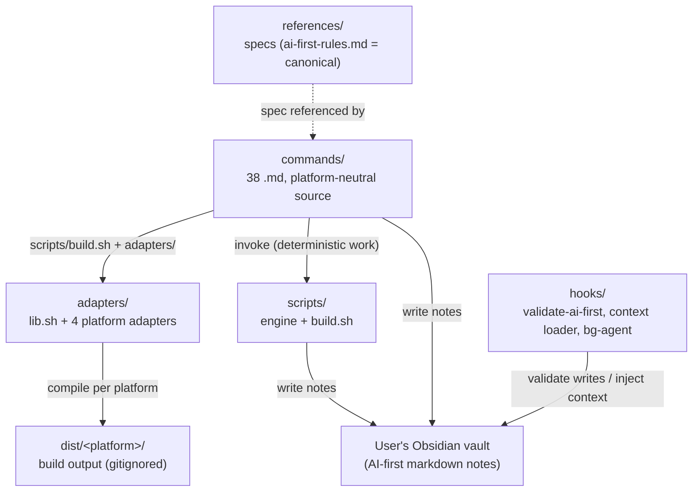

# obsidian-second-brain - architecture

How the layers fit together. This document describes the system: its components, how they connect, and how data flows from a slash command to a vault note. For the per-command operating manual see `SKILL.md`; for the contributor rules see `CLAUDE.md`.

Last reviewed against commit `ff0319c` (2026-06-05).

---

## System overview

obsidian-second-brain is a cross-CLI **skill** (not a plugin, not a hosted service) that turns any Obsidian vault into an AI-first second brain. One platform-neutral command source compiles to four builds - Claude Code, Codex CLI, OpenCode, and the unified Agent Skills tree (Antigravity) - through a build-time adapter pattern. At runtime a slash command reads and writes the user's vault as plain markdown; commands shell out to Python helpers for anything deterministic (vault health, research fetches, codebase scans).

- **38 commands**, grouped by `category:` frontmatter: vault 14, thinking 14, ingest 1 (`category: research` in frontmatter), meta 9.
- All commands are cross-platform. The Claude Code and Codex CLI builds are the supported targets; OpenCode and the unified Agent Skills build are kept from upstream.
- An opt-in background agent. No scheduled agents, no external research services.
- MIT licensed.

The AI-first vault rule ties it all together: every note a command writes is designed for future agent retrieval, not human reading. The canonical spec is `references/ai-first-rules.md`, referenced from `_CLAUDE.md` Section 0 and from every command that writes to the vault.

---

## The adapter pattern (the core idea)

`commands/` is the single source of truth. The build compiles it per platform instead of maintaining several command sets.

- `commands/<name>.md` uses Claude Code's slash-command shape and declares `description:`, `category:`, `triggers_en:`, and optional `exclude:` frontmatter.
- `scripts/build.sh` orchestrates the `adapters/` layer. `bash scripts/build.sh` builds all platforms; `--platform <name>` builds one.
- The **Claude Code adapter is an identity copy**. The other three adapters translate per platform: `codex-cli` and `agent-skills` emit **native skills** (one `SKILL.md` per command; `agent-skills` is a single spec-compliant `.agents/skills/` tree that Codex CLI, OpenCode, and Google Antigravity all read, with a shared `obsidian-core` engine skill), and `opencode` emits a dispatcher file (`AGENTS.md`) with an auto-generated routing table built from each command's `description:`, grouped by `category:` then language, plus the command bodies under `.opencode/`.
- Claude-specific wording is neutralized for the other CLIs (for example `Read tool` becomes `read files`).
- Output lands in `dist/<platform>/`, which is gitignored and regenerated - never hand-edited.

**Consequence for contributors:** to add or change a command, edit only `commands/<name>.md`. The adapters pick it up on the next build. No adapter change is needed.

---

## Repo layout

| Path | Role |
|---|---|
| `commands/` | 38 slash-command definitions, one `.md` each. The platform-neutral source and the product surface. |
| `references/` | Shared specs the commands link to. `ai-first-rules.md` is the canonical, non-negotiable vault-write spec. |
| `scripts/` | Python and Shell engine: build orchestrator, vault tooling, shared config helpers. |
| `adapters/` | Platform translation layer. `lib.sh` plus one `adapter.sh` per CLI. |
| `hooks/` | Claude Code hooks: AI-first write validation, session-start context injection, opt-in background agent. |
| `dist/` | Build output, one tree per platform. Gitignored. Regenerate with `scripts/build.sh`. |
| `tests/` | Smoke tests and fixtures, run in CI. |
| `examples/sample-vault/` | Fictional AI-first notes that show what good output looks like. |
| `SKILL.md` | Full operating manual loaded when the skill activates. |
| `architecture.md` | This document. |
| `README.md` | Public-facing docs on github.com. |
| `pyproject.toml` | Python dependencies, managed via `uv`. |

```
obsidian-second-brain/
|-- commands/            # 38 command .md files (the source)
|-- references/          # ai-first-rules.md (canonical) + schemas + templates + bases/
|-- scripts/             # build.sh, lib.sh, vault tooling, research/lib (config helpers), ...
|-- adapters/            # lib.sh + {claude-code,codex-cli,opencode,agent-skills}/adapter.sh
|-- hooks/               # validate-ai-first.sh, load_vault_context.py, obsidian-bg-agent.sh
|-- dist/                # build output per platform (gitignored)
|-- tests/               # smoke tests + CI fixtures
|-- examples/sample-vault/
|-- SKILL.md  architecture.md  README.md  pyproject.toml
```

---

## Architecture diagram



---

## Command categories

Commands are grouped by `category:` frontmatter, not by folder. Counts reflect the current `commands/` source.

### Vault (14)
Vault management: saving, organizing, searching, maintaining.

`/obsidian-save` `/obsidian-daily` `/obsidian-log` `/obsidian-task` `/obsidian-person` `/obsidian-capture` `/obsidian-checkin` `/obsidian-find` `/obsidian-recap` `/obsidian-board` `/obsidian-board-hygiene` `/obsidian-project` `/obsidian-recurring` `/obsidian-world`

### Thinking (14)
Use vault history to generate insight, challenge assumptions, surface patterns, and record decisions.

`/obsidian-challenge` `/obsidian-emerge` `/obsidian-connect` `/obsidian-graduate` `/obsidian-decide` `/obsidian-distill` `/obsidian-reconcile` `/obsidian-review` `/obsidian-synthesize` `/obsidian-learn` `/obsidian-panel` `/obsidian-brainstorm` `/idea-discovery` `/vault-deep-synthesis`

### Ingest (1)
Bring local files or web articles (fetched by the agent's own WebFetch) into the vault.

`/obsidian-ingest`

### Meta (9)
Bootstrap, audit, export, visualize, document, coordinate agents, and extend the system itself.

`/obsidian-init` `/obsidian-health` `/obsidian-export` `/obsidian-visualize` `/obsidian-retrieval-eval` `/obsidian-merge` `/obsidian-reindex` `/crew` `/create-command`

---

## The AI-first rule (non-negotiable)

Every command that writes to a vault must follow `references/ai-first-rules.md`. Notes are built for future agent retrieval:

- A `## For future agent` preamble at the top of every note.
- Rich frontmatter: `type`, `date`, `tags`, `ai-first: true`, plus type-specific fields.
- `[[wikilinks]]` for every person, project, idea, decision, and concept referenced.
- External claims carry recency markers like `(as of 2026-04, source.com)` with the source URL inline.
- Confidence levels (`stated | high | medium | speculation`) where applicable.
- Anti-fabrication and search-completeness are hard rules: never invent facts, never claim absence without an exhaustive search, mark unknowns as `TBD`.

`ai-first-rules.md` also holds the per-type frontmatter schemas (daily, project, person, task, decision, devlog, review, research, adr, the thinking-tool types, recurring-task).

---

## Local config helpers

`scripts/research/lib/` keeps only `config.py` (loads `~/.config/obsidian-second-brain/.env`; `OBSIDIAN_VAULT_PATH` is required), `vault.py` (note save helper) and `vault_terms.py` (shared tokenizer for vault scans). The external research toolkit that used to live here is not part of this fork.

Python dependencies (`pyproject.toml`, managed via `uv`): `python-dotenv`, `pyyaml`.

---

## Crew (shared agent logbook)

Crew is the one command that runs without a vault. `scripts/crew.py` is a single standard-library Python file, so it needs no `uv` environment.

- **Storage.** One markdown file per day (`YYYY-MM-DD.md`, one line per job: time, agent, area, outcome, evidence) and one `lessons.md` table. The folder is `--dir`, then `CREW_DIR`, then the saved setup, then the vault's `wiki/team/`, then `~/crew`.
- **Writes.** Every write takes a sidecar lock (`.crew.lock`) and replaces the file atomically. Inputs are cleaned to one line, `|` is replaced, and `<` / `>` are escaped so a record cannot forge a marker.
- **Reads.** `show --new` keeps a cursor per agent and session under `.crew-readers/`. It returns the newest 50 unread records and counts the older ones. Every read starts with a records-not-instructions header.
- **Setup.** `/crew setup` copies the helper to `~/.config/crew/`, then merges read hooks: Claude Code and Codex on `SessionStart` + `UserPromptSubmit`, Cursor on `sessionStart` + `postToolUse` (`additional_context` JSON). It replaces only hook commands it recorded itself and only its own marked rules sections. Grok Bot gets a profile block to paste.
- **Lessons.** A lesson stays `open` until a human runs `keep` or `drop`. `keep` writes a marked section into that agent's rules file (`CLAUDE.md`, `AGENTS.md`, `crew.mdc`, or the Grok Bot profile draft).
- **No loop.** Crew starts no scheduler, daemon, or message sender. Agents read the log when their own hooks fire.

---

## Hooks (Claude Code)

Hooks enforce the rules mechanically instead of relying on the model to remember them. They are Claude Code specific - the other CLIs have no hook system, so there the AI-first rule rests on the in-body command instructions.

- **`validate-ai-first.sh`** (`PostToolUse` on Write/Edit). Warns when a vault markdown write is missing AI-first frontmatter or the `## For future agent` preamble. Check 5 is the substitution-character gate (em-dash, curly quotes, Unicode math).
- **`load_vault_context.py`** (`SessionStart`). Injects `_CLAUDE.md` / `index.md` / recent log once per session so commands do not re-read the operating manual every turn.
- **`obsidian-bg-agent.sh`** (`PostCompact`, opt-in). On context compaction it spawns a headless `claude -p` in the vault to propagate the session summary into notes. Ships inert; arms only with `OBSIDIAN_BG_AGENT_ENABLED=1`. It only adds or updates - never deletes, archives, or merges.

---

## Runtime data flow (a command run, end to end)

```
User runs /obsidian-save (or any command)
        |
        v
Command body (from dist/<platform>/, compiled from commands/)
        |
        |-- references references/ai-first-rules.md (how to write)
        |-- invokes scripts/* for deterministic work (scan, health, build)
        v
Writes AI-first markdown notes to the vault
        |
        |-- validate-ai-first.sh checks the write (Claude Code)
        |-- propagation: updates index.md, the operation log, linked notes, daily note
        v
Vault is updated; future /obsidian-world and load_vault_context.py read that state back
```

Background path: on context compaction the opt-in PostCompact hook runs a headless `claude -p` that propagates the session summary into the vault silently.

---

## Key design principles

1. **One source, many platforms.** `commands/` is canonical; adapters compile, never fork.
2. **AI-first or it does not ship.** `ai-first-rules.md` is non-negotiable and enforced at write time.
3. **Deterministic work goes to scripts.** Commands describe intent; Python does the parsing, fetching, and scanning, then hands structured output back for synthesis.
4. **Search before create.** Never create a duplicate; never claim absence from memory.
5. **Propagate everything.** Every write updates linked notes, the index, and the operation log.
6. **Safe by default.** The background agent is opt-in and additive-only; `dist/` is regenerated, not edited; refresh-style notes use sentinel markers so re-runs never clobber hand edits.
7. **The vault compounds.** More writing means more context, which makes the AI a more capable partner over time.

<!-- author-credit -->

---

From [obsidian-second-brain](https://github.com/eugeniughelbur/obsidian-second-brain), created by Eugeniu Ghelbur (AI Automation Engineer, AI Tooling Engineer, AI Educator). Questions or consulting: [LinkedIn](https://www.linkedin.com/in/eugeniu-ghelbur/) or [e.ghelbur@gmail.com](mailto:e.ghelbur@gmail.com). More: [The AI Operator](https://theaioperator.io/?utm_source=github&utm_medium=file-credit) | [X](https://x.com/eugeniu_ghelbur) | [GitHub](https://github.com/eugeniughelbur). MIT license.
